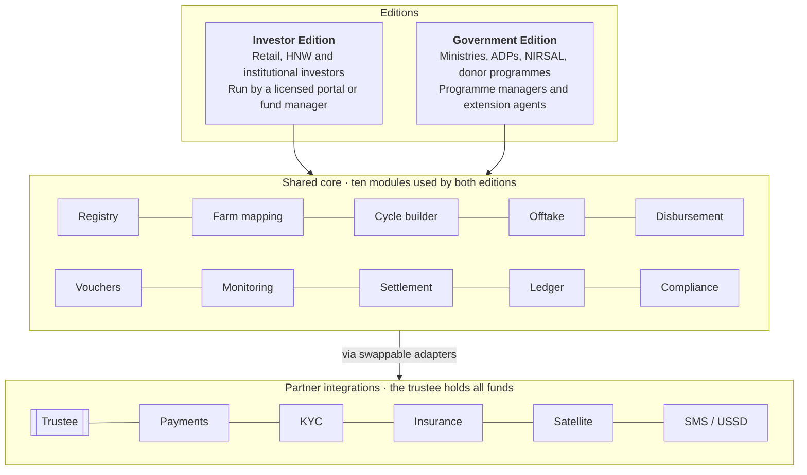
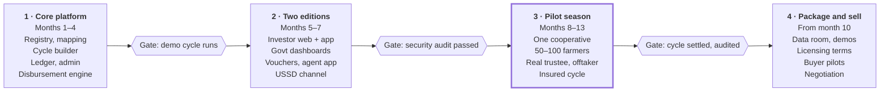

# Agrowth 2.0 — Platform Remodel Concept

Nov 4, 2026 · @Ayo · Living version: [Claude Doc](https://claude.ai/artifact/GW71TVb5sXPwS73Nv374w2)

## Executive summary

Agrowth 2.0 is an agricultural finance platform that makes farm investment verifiable: money is held by a licensed trustee, released in stages as inputs, and repaid from pre-contracted harvest sales. It is built once as a shared core and packaged as two editions for two buyer types.

- **Investor Edition** — sold or licensed to an SEC-registered operator (fund manager, bank, fintech, crowdfunding portal) who wants an agriculture product. Retail and institutional investors fund verified farm cycles for a variable profit share.
- **Government Edition** — sold or licensed to a state or federal agriculture body. It runs input-credit programmes: farmer registry, in-kind disbursement, field monitoring, offtake-based repayment and reporting.

The owner's goal is to build the product and sell it, not to operate it. So the deliverable is a working platform, a clean licensing story and a credible pilot, packaged for a buyer who holds (or will obtain) the licences.

**What changed from Agrowth 1.0:** no guaranteed returns, no platform custody of funds, no funding before an offtake buyer is signed, and every farm verified on the map and in the field.

## Why the original model failed

Agrowth 1.0 copied a model that has failed across Nigeria and the wider continent: promise retail investors a fixed return on a farm cycle, collect the money centrally, and hope the harvest covers it. The record is consistent.

- **Leaders pivoted out.** Farmcrowdy left crowdfunding in 2021 and became a B2B food value-chain business. ThriveAgric nearly collapsed in 2020 over unpaid retail investors, then dropped public crowdfunding for institutional capital. [WeeTracker, May 2026](https://weetracker.com/2026/05/29/crowdfunding-agritech-collapses-africa/)
- **Many smaller platforms vanished.** Farm Power, Payfarmer, Goldvest, Emerald Farms, HO Corn, FarmKonnect and others left investors unable to recover funds. [Nairametrics, 2023](https://nairametrics.com/2023/07/23/big-read-the-dark-twisted-world-of-nigerias-agro-crowdfunding-industry)
- **Returns were impossible.** Platforms advertised 20–50% a year, some 10% a month, which no farm cycle can sustain. [Nairametrics, 2022](https://nairametrics.com/2022/01/30/why-many-crowdfunding-platforms-are-failing-in-nigeria/)
- **New money paid old money.** Some platforms settled maturing investors with fresh deposits. [The Condia](https://thecondia.com/rise-pivot-agritech-crowdfunding-platforms-crowdyvest/)
- **Insurance didn't protect investors.** ThriveAgric's cover insured the farming, not the investor's capital. [TechCabal](https://techcabal.com/?p=90280)

Government-led agric credit has its own failure mode. The CBN's Anchor Borrowers' Programme released about ₦1.08 trillion; by February 2023 only 52.39% of what was due had been repaid, and the IMF put recovery far lower. [Nairametrics](https://nairametrics.com/2023/03/06/cbn-says-farmers-have-only-repaid-52-3-of-loans-under-anchor-borrowers-programme) The IMF blamed weak repayment incentives and poor targeting of recipients. [Ripples Nigeria](https://www.ripplesnigeria.com/imf-reveals-problems-with-cbns-anchor-borrowers-programme/?amp)

**The common causes:** returns set by marketing rather than farm economics; operators holding the money; cash handed to farmers; no independent proof that farms existed; no buyer locked in for the harvest; and political or social pressure that weakened repayment. Agrowth 2.0 is designed to remove each of these.

## The remodel: six design principles

Each principle answers one failure from the previous section. They apply to both editions and are enforced in software, not left to the operator's goodwill.

| # | Principle | What the platform enforces | Failure it removes |
| --- | --- | --- | --- |
| 1 | Trustee custody | Investor or programme funds sit in a trustee/custodian escrow account. The platform only issues release instructions; it never holds money. | Operator diverting or recycling funds |
| 2 | Offtake first | A farm cycle cannot open for funding until a signed offtake agreement (buyer, volume, price floor or formula) is uploaded and approved. | No guaranteed market for the harvest |
| 3 | In-kind, staged disbursement | Funds are released per crop milestone (land prep, planting, mid-season, harvest), mostly as vouchers paid straight to approved input vendors and service providers. | Cash leakage at farm level |
| 4 | Insured downside | Every funded cycle carries area-yield or weather-index insurance, with the investor or programme named as loss payee. | Losses landing entirely on investors |
| 5 | Verified farms | Geo-mapped farm boundaries, satellite crop-health checks, and timestamped field-agent visits with photos. Milestone releases need a passed verification. | Ghost farms and fake progress reports |
| 6 | Honest, variable returns | Returns are a share of actual harvest proceeds after costs. Projections show a low–expected–high range from historical yields and prices; nothing is guaranteed. | Unsustainable promised returns |

Two further rules follow. **Repayment comes from the sale, not the farmer:** the offtaker pays into the trustee account, which splits proceeds by a pre-agreed waterfall (input costs, insurance, investor share, farmer share, fees). **No recycling:** the ledger ties every naira to one cycle, so one cycle's money can never pay another's investors.

## Platform architecture

One shared core does the hard work; each edition is a thin layer of screens, roles and reports on top of it. This keeps the build manageable and lets the same product be sold twice.

The platform only sends instructions to partners. Money sits with the trustee, risk sits with the insurer, and the harvest goes to the offtaker, so no buyer has to trust the software company with funds.

## Core modules

Ten modules make up the shared core; both editions use all of them. Build these first, because they are what a buyer is really paying for.

| Module | What it does | Key users |
| --- | --- | --- |
| Farmer & cooperative registry | Onboards farmers with BVN/NIN check, photo, phone, bank or wallet, cooperative membership and farming history. Deduplicates against existing records. | Field agents, admins |
| Farm mapping | Captures farm boundaries by GPS walk or satellite tracing; stores hectares, crop, soil notes and land-tenure documents. | Field agents |
| Cycle builder | Defines a funding cycle: crop, hectares, budget per hectare, milestone schedule, yield and price assumptions, offtake contract, insurance policy. | Cycle managers |
| Offtake contracts | Stores buyer agreements, volumes, price terms and delivery windows; tracks delivery against contract. | Offtakers, cycle managers |
| Disbursement engine | Turns approved milestones into release instructions to the trustee: input vouchers to vendors, service payments, limited cash. | Trustee, vendors |
| Vendor & voucher network | Registers approved agro-dealers and service providers; farmers redeem vouchers by code or QR; vendors are paid on redemption. | Agro-dealers, farmers |
| Field monitoring | Offline-first mobile app for agent visits: checklists, geotagged photos, pest and disease reports. Adds satellite vegetation-index checks per farm. | Field agents, monitors |
| Harvest & settlement | Records harvest weights, quality grades and delivery to offtaker; runs the proceeds waterfall and issues statements. | Aggregators, trustee |
| Ledger & reporting | Immutable per-cycle ledger of every inflow and outflow; audit trail; regulatory and programme reports; data export. | Auditors, regulators, buyers |
| Admin & compliance | Roles and permissions, KYC/AML checks, approvals workflow, risk flags, document vault. | Compliance officers |

Farmers can use the system through a USSD/SMS channel and assisted onboarding by agents, since many smallholders don't use smartphones.

## Investor Edition

The Investor Edition lets a licensed operator offer farm cycles to retail and institutional investors, with every naira traceable from wallet to field to buyer.

**Who uses it**

- Retail investors (capped by SEC rules to 10% of net annual income across all crowdfunding)
- High-net-worth and institutional investors (no cap), including funds that want an agriculture allocation
- The operator's investment, compliance and operations teams

**Investor-facing features**

- Onboarding with tiered KYC (BVN, NIN, ID, proof of income), investor classification and automatic cap enforcement
- Cycle marketplace: each listing shows the farm map, offtaker, insurer, budget, milestone plan, a low–expected–high return range and a plain-language risk score
- Live cycle tracker: milestone timeline, field photos, satellite crop health, disbursements made and harvest progress
- Wallet and payments funded through the trustee account; payouts to bank accounts on settlement
- Statements, tax documents and a full per-investment transaction history
- Risk disclosures that must be acknowledged before each investment; cooling-off period
- Later phase: a secondary marketplace so investors can sell positions before a cycle ends, if the operator's licence permits

**Operator features**

- Cycle approval workflow (offtake, insurance, verification and legal sign-off before listing)
- Investor-cap and suitability engine, AML monitoring, regulatory returns to the SEC
- White-label branding, fee configuration (listing fee, management fee, performance share)

**How money moves:** the investor funds the trustee account → the cycle closes when fully subscribed → the trustee releases funds per milestone to vendors → the offtaker pays the trustee at harvest → the trustee runs the waterfall and pays investors. If a cycle doesn't fill by its deadline, the trustee refunds investors in full.

## Government Edition

The Government Edition lets a ministry, agency or development-finance body run input-credit and subsidy programmes with measurable delivery and recovery. The pitch is simple: past programmes lost money because nobody could see who got what and whether it came back; this system makes that visible.

**Likely buyers**

- State Ministries of Agriculture and state agricultural development programmes (ADPs)
- Federal Ministry of Agriculture and Food Security and its agencies
- Development-finance and risk-sharing bodies such as NIRSAL and the Bank of Agriculture
- Donor-funded programmes (World Bank, IFAD, AfDB, Gates-funded projects) that need traceable disbursement

**Government-specific features**

- Programme designer: define eligibility, commodities, input packages, loan or grant terms, and target local government areas
- State-wide farmer registry with deduplication, so one farmer can't enrol twice or under a fake name
- Input voucher distribution through registered agro-dealers instead of bulk input handouts
- Repayment in cash or produce via approved aggregators and warehouses, linked to offtake contracts
- Dashboards by state, LGA, ward, commodity and cooperative: hectares funded, inputs delivered, yields, repayment rate, defaulters
- Extension-agent management: assignments, visit compliance, training records
- Audit exports for the Auditor-General, donors and legislative oversight; open-data summaries for public accountability

**What it can replace or strengthen:** paper-based farmer lists, unverifiable distribution records, and repayment tracking that sits in spreadsheets. It can also co-finance: a state can fund part of a cycle and let licensed investors fund the rest through the Investor Edition.

## Key user flows

Four flows carry the product. The demo for buyers should walk through the first one from start to finish.

**1. A farm cycle, end to end**

1. A cooperative applies; field agents register farmers and map the farms.
2. The cycle manager builds the cycle: crop, hectares, budget, milestones, yield and price assumptions.
3. An offtaker signs the agreement and an insurer binds the policy; both are uploaded.
4. Compliance approves; the cycle is listed (Investor Edition) or allocated a programme budget (Government Edition).
5. Funds reach the trustee account; the cycle closes once fully funded, or refunds on the deadline.
6. At each milestone, an agent visit and a satellite check must pass before the trustee releases that tranche to vendors.
7. Farmers redeem input vouchers at approved agro-dealers.
8. Harvest is weighed, graded and delivered to the offtaker.
9. The offtaker pays the trustee; the waterfall runs; statements go out; the cycle is closed in the ledger.

**2. Investor onboarding and investment**

1. Sign up, complete KYC and income declaration; the system sets the investment cap.
2. Browse cycles, read the risk disclosure, acknowledge it.
3. Fund through the trustee account; receive a certificate and access to the live tracker.
4. Receive payout and statement at settlement.

**3. Field agent visit (offline)**

1. Agent opens the day's assigned farms on the mobile app, works offline.
2. At each farm: GPS check-in inside the mapped boundary, checklist, photos, issues flagged.
3. Data syncs when back in coverage; failed checks hold the next disbursement and alert the cycle manager.

**4. Crop failure and insurance claim**

1. Satellite and agent reports flag damage; the insurer is notified automatically.
2. Loss assessment is recorded against the affected farms.
3. The claim payout goes to the trustee and flows through the same waterfall, so investors and the programme see exactly what was recovered.

## Regulatory and legal setup

The Investor Edition is a regulated activity; the buyer must hold the licences, and the platform must make compliance easy. Selling it as a technology product (not as a running investment business) keeps the builder outside the regulated perimeter. This section is not legal advice; a capital-markets lawyer should confirm it before any launch or sale.

**What applies**

- **SEC Rules on Crowdfunding (in force 21 January 2021).** Anyone operating a crowdfunding portal in Nigeria, or targeting Nigerian investors, must register with the SEC. Retail investors are capped at 10% of net annual income across crowdfunding; HNW and qualified institutional investors are uncapped. [Mondaq](https://mondaq.co.uk/nigeria/securities/1432010/your-questions-about-investment-based-crowdfunding-answered) · [Financial Nigeria](https://www.financialnigeria.com/how-the-isa-2025-reshapes-nigeria-s-crowdfunding-regulation-feature-597.html)
- **Commodities investment platforms.** The rules have a category for platforms offering agricultural investments; the fundraising limits for MSMEs don't apply to them, but they must host their offers on a registered crowdfunding portal. [Mondaq](https://mondaq.co.uk/nigeria/securities/1432010/your-questions-about-investment-based-crowdfunding-answered) · [S&S Kohn](https://sskohn.com/?p=5065)
- **Investments and Securities Act 2025** (signed 31 March 2025, repealing ISA 2007). It expands SEC oversight of crowdfunding, requires registration of securities issued through portals, and adds pre-clearance and disclosure requirements. [Financial Nigeria](https://www.financialnigeria.com/how-the-isa-2025-reshapes-nigeria-s-crowdfunding-regulation-feature-597.html) It expressly prohibits Ponzi and pyramid schemes, with penalties reported at up to 10 years' imprisonment and a ₦20 million fine. [Mondaq](https://www.mondaq.com/nigeria/securities/1620400/review-of-the-investment-and-securities-act-of-2025) · [WeeTracker](https://weetracker.com/2026/05/29/crowdfunding-agritech-collapses-africa/)
- **Data protection.** The Nigeria Data Protection Act 2023 governs farmer and investor personal data (BVN, NIN, location).
- **Payments.** Wallets and payment flows run through a CBN-licensed payment partner and the trustee's bank, never through the platform company.

**Licensing routes for an Investor Edition buyer**

| Route | Who it suits | Notes |
| --- | --- | --- |
| Buyer already registered as a crowdfunding portal | Existing portals adding an agri vertical | Fastest; the platform plugs into their licence |
| Buyer is a registered fund manager | Asset managers | Structure cycles as a collective investment scheme or private fund for HNW/institutional investors |
| Buyer registers a new portal | Banks, fintechs, new entrants | Slowest; the compliance features in the platform help their application |

**Legal documents to prepare with the build:** template offtake agreement, trustee/escrow agreement, investor terms and risk disclosure, farmer/cooperative participation agreement, vendor agreement, data-processing agreement, and a software licence or asset-purchase agreement for the sale itself.

**Government Edition:** procurement follows the Public Procurement Act and state equivalents. Expect an open or selective tender, or a pilot under a memorandum of understanding first; data residency and source-code escrow are common asks.

## Partners and integrations

The platform depends on partners it doesn't own. Build adapters so the buyer can swap providers; the names below are examples to approach, not confirmed relationships.

| Role | Why it's needed | Example providers |
| --- | --- | --- |
| Trustee / custodian | Holds all funds; executes release and payout instructions | Licensed trustee companies (e.g. bank-affiliated trustees) |
| Payments | Collections, vendor payouts, investor payouts | Paystack, Flutterwave, Interswitch, NIBSS |
| Identity / KYC | BVN and NIN verification, liveness checks | Smile ID, Prembly, Dojah |
| Insurance | Area-yield or weather-index cover per cycle | NAIC, Pula, private insurers |
| Offtakers | Contracted buyers for each crop | Millers, processors, breweries, FMCG firms, exporters |
| Aggregation & storage | Collection, grading, warehousing, produce-based repayment | Commodity exchanges and warehouse operators (e.g. AFEX) |
| Satellite data | Crop-health and boundary checks | Sentinel-2 imagery via Sentinel Hub or Google Earth Engine |
| Weather | Forecasts and triggers for alerts and index insurance | Commercial weather APIs, NiMet |
| SMS / USSD | Farmer access without smartphones | Africa's Talking or local aggregators |
| Agro-dealers | Redeem input vouchers | Registered dealer networks, input companies' distributors |

## Technology stack and build plan

Use mainstream, well-documented tools so a buyer's team can maintain the platform after handover. Suggested stack:

| Layer | Choice | Why |
| --- | --- | --- |
| Backend | Python (Django) or TypeScript (NestJS) with PostgreSQL + PostGIS | Strong for ledgers and geospatial farm data; easy to hire for in Nigeria |
| Ledger | Double-entry, append-only tables per cycle | Audit-ready; no edits, only reversing entries |
| Web apps | Next.js (investor portal, admin, government dashboards) | One codebase for all web surfaces; white-label theming |
| Mobile | Flutter or React Native, offline-first with background sync | Field agents work without coverage; investors get a native app |
| Farmer channel | USSD and SMS through an aggregator | Reaches farmers without smartphones |
| Geospatial | Sentinel-2 imagery, NDVI processing in Python | Free imagery; automated crop-health checks |
| Hosting | Containerised (Docker), cloud or local data centre | Meets data-residency asks from government buyers |
| Security | Role-based access, encryption at rest, audit logs, 2FA | Required by trustees, regulators and procurement |

The timeline below assumes one lead developer plus contractors for mobile and security; working alone roughly doubles Phases 1–2.

The pilot is the critical phase: it turns a demo into evidence. Selling starts in month 10, while the pilot is still running, so early buyer conversations can shape the final product.

## Sale strategy

Buyers pay for proof, not code: a working platform plus one settled pilot season is worth far more than a feature-complete product nobody has used. Start talking to buyers during the build, not after it.

**Who to approach, in order of likely speed**

| Buyer type | What they want | Likely deal |
| --- | --- | --- |
| Registered crowdfunding portals and fintechs | A ready agri vertical that fits their licence | Licence + implementation fee, or outright purchase |
| Fund managers and banks with agri lending | Traceable deployment of agri capital to HNW/institutional clients | Licence or white-label SaaS |
| Donor-funded programmes and NGOs | Transparent disbursement and reporting for a funded project | Per-programme licence; often the fastest public-sector-adjacent route |
| State ministries / ADPs | Farmer registry, input-credit tracking, recovery dashboards | Pilot under an MoU, then a tender or direct contract |
| Federal agencies (FMAFS, NIRSAL, BOA) | National-scale registry and credit tracking | Long sales cycle; best approached with a state reference |

**Ways to sell it**

- **Outright sale of the IP and codebase.** One payment; clean exit. Lowest total value unless there is pilot traction.
- **Perpetual licence per buyer.** Sell the same platform to several non-competing buyers (one portal, one state, one donor programme). Best fit for "build and sell" without running the business.
- **SaaS subscription.** Recurring fees per active farmer, hectare or programme. Highest long-term value, but needs ongoing hosting and support, which conflicts with not operating it.
- **Hybrid.** Licence fee up front, plus a fixed-term support contract (6–12 months) handed to a maintenance partner afterwards.

Pricing depends on traction and buyer size; set it with a corporate-finance or M&A adviser once pilot results exist.

**What to have ready (the data room)**

- [ ] Live demo environment with realistic sample data, scripted around the end-to-end cycle flow
- [ ] Pilot results: farmers, hectares, disbursement and repayment figures, audited ledger
- [ ] Technical documentation: architecture, API docs, deployment guide, test coverage
- [ ] Independent security review and penetration-test report
- [ ] Clean IP: all code owned by you, contributor and contractor IP assignments, open-source licence list
- [ ] Legal templates (offtake, trustee, investor, farmer, vendor agreements)
- [ ] Regulatory memo from a capital-markets lawyer on how a buyer licenses the Investor Edition
- [ ] Financial model showing the buyer's revenue per cycle or per programme
- [ ] Pitch deck, one for each buyer type
- [ ] Handover plan: who maintains the system after sale

**Before building everything, try to get a letter of intent.** One buyer willing to pilot shapes the product and becomes the reference that sells the rest.

## Risks and open questions

The biggest risk is building a complete product with no buyer or pilot lined up. Most of the others can be designed around.

| Risk | Effect | Mitigation |
| --- | --- | --- |
| No buyer signs | Effort produces an unsold product | Seek a letter of intent before Phase 2; build the core first so it can be shown early |
| Pilot needs a licensed operator | A real investor-funded pilot can't run without one | Run the first pilot on the Government/donor side, or with a partner's licence |
| Reputation of agri crowdfunding | Buyers and investors distrust the category | Lead with custody, offtake and verification; publish the pilot ledger |
| Partner dependency | A trustee, insurer or offtaker withdraws | Adapters for swappable providers; at least two options per role |
| Field data quality | Agents fake visits or photos | GPS-boundary check-ins, photo metadata checks, satellite cross-checks, random audits |
| Government procurement delays | Sale takes years | Treat government as the second sale; use donor programmes as a bridge |
| Political interference in repayment | Recovery collapses, as with past programmes | Repayment through offtakers and warehouses, not farmer goodwill; public dashboards |
| Builder capacity | One person can't build, pilot and sell at once | Hire contractors for mobile and security; bring in a part-time sales/BD partner on commission |

**Open questions to settle next**

- [ ] Which crops for the pilot? Short-cycle crops with established buyers (maize, soybean, rice, sesame) settle faster.
- [ ] Which state, cooperative and offtaker for the pilot?
- [ ] Build alone, or with contractors? This sets the timeline.
- [ ] Which buyer to approach first for a letter of intent?
- [ ] Keep the Agrowth name, or rebrand to separate it from the old model?
