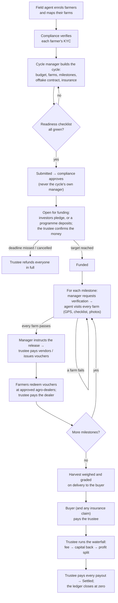

# Agrowth 2.0 — Platform Guide

What the platform does today, how it works, what every role can do, how to use it step by step, and what is still to be built.

_Status as of 7 November 2026. Related documents:_

- _[Demo Guide](demo-guide.md): opening or setting up the demo, and a scripted tour._
- _[Design Rationale](design-rationale.md): why the platform is designed this way._
<!-- - _[Concept document](agrowth-2.0-concept.md): the original remodel concept._ -->
- _[README](../README.md): developer setup, and a manual walkthrough with exact values._

---

## Contents

1. [What Agrowth is](#1-what-agrowth-is)
2. [Where the project stands](#2-where-the-project-stands)
3. [How it works: the life of a farm cycle](#3-how-it-works-the-life-of-a-farm-cycle)
4. [Roles and accounts](#4-roles-and-accounts)
5. [How to use the app, role by role](#5-how-to-use-the-app-role-by-role)
6. [The two editions](#6-the-two-editions)
7. [The rules the system enforces](#7-the-rules-the-system-enforces)
8. [Running the platform](#8-running-the-platform)
9. [What is yet to be done](#9-what-is-yet-to-be-done)

---

## 1. What Agrowth is

Agrowth is a platform that makes farm finance verifiable. Money for a farming season is held by a licensed **trustee**, never by the platform. It is released in stages, mostly as **inputs paid straight to approved agro-dealers**, and only after a field agent has **checked every farm in person**. The harvest is **already sold** to a contracted buyer (the offtaker) before any money is raised, and the crop is **insured**. When the buyer pays, the trustee splits the proceeds by a fixed **waterfall** and pays everyone out.

One shared core runs two editions for two kinds of funding:

- **Investor Edition**: investors fund farm cycles for a share of the harvest profit. Offering investments to the public is regulated, so this edition runs under an SEC-registered operator (a crowdfunding portal, fund manager or bank).
- **Government Edition**: ministries, agencies and donor programmes run input-credit or grant schemes and see who got what, and what came back.

How the platform reaches the market is still open. It could be operated directly or with partners, or licensed to organisations that run it themselves. This guide describes the product and how it works, not a commercial model.

---

## 2. Where the project stands

**Phase 1 (core platform)** and **Phase 2 (two editions)** are complete. The USSD/SMS farmer channel and the security audit have moved to **Phase 3**, which is on hold. The current work is replacing the simulated outside parties (trustee, payments, identity and the rest) with live integrations; see [section 9](#9-what-is-yet-to-be-done).

| Area | What it does | State |
| --- | --- | --- |
| Accounts and roles | Sign-up, sign-in, admin assigns roles, deactivation | Done |
| Farmer registry | Cooperatives, farmer enrolment with NIN/BVN duplicate check, KYC review | Done |
| Identity checks | NIN and BVN looked up with an identity provider at enrolment and investor KYC; verifying needs a match or a written reason. Provider: Dojah; runs simulated until its keys are added | Done |
| Farm mapping | Draw on satellite imagery or GPS-walk the boundary; area computed; overlapping farms refused | Done |
| Cycle builder | Budget, yield and price ranges, farms, milestones, offtake contract, insurance, documents | Done |
| Approval | Readiness checklist, compliance review, separation of duties | Done |
| Funding | Trustee-confirmed deposits; full refunds if a cycle misses its deadline or is cancelled | Done |
| Field verification | GPS check-in inside the boundary, checklist, photos; a failed visit blocks the money | Done |
| Disbursement | Staged releases per milestone, 20% cash cap, trustee-confirmed payments | Done |
| Vendors and vouchers | Agro-dealer registry; per-farm input vouchers redeemed at the shop counter; vendors paid on redemption | Done |
| Ledger | Double-entry, append-only, balanced, no money moving between cycles | Done |
| Trustee bank files | Bulk-payment files for the trustee's bank; statement imports that confirm payments and pledge payments by reference and flag the rest | Done |
| Insurance claims | Losses reported with weather and field-visit evidence, the insurer notified, the assessment and approved amount recorded, and the payout received against the claim | Done |
| Weather per farm | Daily rainfall and temperatures for every farm in a live cycle, from Open-Meteo, against the 10-year normal; a Weather tab per cycle, and dry-spell, very-wet, heavy-rain and heat flags on the overview | Done |
| Online payments | Investors pay pledges through Paystack (or a simulated gateway on the demo), settled to the trustee and confirmed by webhook; problem payments flagged for refund | Done |
| Harvest and settlement | Weighed and graded deliveries, buyer and insurance receipts, payout waterfall, statements | Done |
| Portfolio dashboard | Staff overview: money raised, released and repaid, pipeline, map, what needs attention | Done |
| **Investor Edition** | Investor KYC and classification, retail cap, risk disclosure, marketplace, pledges with cooling-off, live tracker, statements, certificates | Done |
| **Government Edition** | Programmes with eligibility and budgets, dashboards by state/LGA/ward/commodity/cooperative, repayment, agent visit record, audit and open-data exports | Done |
| **Offline agent app** | Installs on a phone's home screen; visits recorded with no signal and sent later | Done |
| USSD / SMS farmer channel | Farmers without smartphones check vouchers and status; SMS alerts | Phase 3 (on hold) |

**Code and tests.** The web app is React + TypeScript; the database is Supabase (PostgreSQL + PostGIS), where every business rule lives. There are 299 automated tests: 224 run the real database migrations and the identity, payment and weather provider code and prove the rules; 75 cover the web app's logic, including reading bank statements. A demo seed builds a lived-in portfolio through the same rules.

**Code.** Phases 1 and 2 are merged into `main`. The demo Supabase project has every migration applied.

---

## 3. How it works: the life of a farm cycle

A **cycle** is one season of one crop on a set of farms, with a funding target. Everything in the platform hangs off cycles.

**The money, in the ledger.** Every naira is recorded twice (double-entry), per cycle:

- **Deposit:** the trustee's cash goes up; what the cycle owes its funders goes up.
- **Release:** cash goes down; money "deployed to farms" goes up. Voucher money is first ring-fenced, and paid to the dealer only when the farmer redeems it.
- **Settlement:** the buyer's payment comes in, and the waterfall pays out in this order:
  1. the **management fee** (a % of capital),
  2. **funders' capital** back,
  3. the **profit**, split between funders (an agreed %) and farmers (by kilograms each delivered).

  If the harvest falls short, funders share the loss in proportion. At the end the trustee holds nothing for that cycle.

**Cycle statuses:** Draft → Awaiting approval → Open for funding → Funded → In progress → Harvested → Settled (or Cancelled / Refunded).

---

## 4. Roles and accounts

Everyone who signs up starts as an **investor**. Only an **admin** can give an account a staff role, and nobody can change their own role. Roles decide what each person sees in the menu and, more importantly, what the database allows them to do.

### What each role can do

| Role | Who it is | Can do | Cannot do |
| --- | --- | --- | --- |
| **Admin** | The operator's system administrator | Assign roles, deactivate accounts, link a shop's counter account to its vendor, edit investor settings (caps, cooling-off, escrow account, risk disclosure); everything a manager, agent or compliance officer can do | Confirm money (that's the trustee only); change their own role |
| **Field agent** | Extension officer in the field | Create cooperatives, enrol farmers, map farms, register vendors, record verification visits (online or offline), record harvest deliveries | Verify KYC, approve anything, touch money |
| **Compliance officer** | The operator's compliance team | Verify or reject farmer KYC and investor KYC (and classify investors), approve or return cycles, approve or suspend vendors, void a wrong redemption, read the ledger | Build cycles, confirm money, approve a vendor they registered |
| **Cycle manager** | Runs cycles for the operator | Build and edit draft cycles, submit them, request field verification, instruct milestone releases, complete the harvest, close vouchers, cancel cycles | Approve their own cycle, confirm money |
| **Programme manager** | Government or donor programme lead | Everything a cycle manager can, plus design, activate and close **programmes**, and see programme dashboards | Approve cycles, confirm money |
| **Trustee** | The licensed custodian's operations staff | Confirm deposits and investor payments, refund funders, execute release payments, issue vouchers, pay vendors, record buyer and insurance receipts, run settlement, pay payouts; read the ledger and investor payout accounts | Build or approve cycles; pay more than it holds for a cycle |
| **Auditor** | Internal or external auditor, donor monitor | Read everything: registry, cycles, ledger, investors, programme dashboards, audit exports | Change anything |
| **Vendor** | Counter staff at an approved agro-dealer | Check and redeem farmers' input vouchers at their shop | See anything else |
| **Investor** | Retail, high-net-worth or institutional investor | Complete KYC, browse open cycles, pledge, withdraw before payment is confirmed, track their cycles, see statements and certificates | See farmer names, account numbers, other investors, or any cycle they haven't funded (except open listings) |
| _Offtaker_ | _The harvest buyer_ | _Role exists; no portal yet_ | — |

### Demo accounts

The demo project (`npm run seed:demo`) creates these accounts, all with the one demo password:

| Account | Role | Name | What's waiting for them in the demo |
| --- | --- | --- | --- |
| `admin@agrowth.test` | Admin | Ngozi Adeyemi | Users page; investor settings |
| `manager@agrowth.test` | Cycle manager | Tolu Akinwale | A draft with two failing checks; releases to instruct |
| `programme@agrowth.test` | Programme manager | Hadiza Abdullahi | The Kano wheat programme: one settled season, one under way |
| `agent@agrowth.test` | Field agent (north) | Damola Ogunleye | Farms awaiting verification visits |
| `agent.benue@agrowth.test` | Field agent (Benue) | Terver Iorliam | Benue farms |
| `compliance@agrowth.test` | Compliance officer | Fatima Bello | A cycle to approve, a vendor and an investor to review |
| `trustee@agrowth.test` | Trustee | Kemi Adebayo | A harvested cycle to settle, deposits and pledges to confirm |
| `auditor@agrowth.test` | Auditor | Ibrahim Musa | Read-only view of everything |
| `vendor@agrowth.test` | Vendor | Bala Sule | The counter at Zaria Agro Inputs |
| `investor@agrowth.test` | Investor (high-net-worth) | Adaeze Okoro | One paid-out investment, one live cycle to track |
| `investor.retail@agrowth.test` | Investor (retail) | Funmilayo Adeleke | A pledge still in its 48-hour cooling-off |
| `investor.new@agrowth.test` | Investor (KYC pending) | Emeka Obi | Waiting for compliance |

The portfolio holds 4 cooperatives, 43 farmers and 9 cycles, one at every stage: two settled maize and soybean seasons (one a drought year rescued by insurance), last season's settled programme wheat, a harvested rice cycle ready to settle, maize in progress with vouchers and a blocked release, this season's programme wheat with visits under way, soybean open for funding, sorghum awaiting approval, and a draft.

---

## 5. How to use the app, role by role

Sign in at the app's address. On the demo there's a button per account and a **Demo: switch account** menu in the sidebar. The menu on the left only shows what your role can use.

### Admin: setting up people

1. **Users** lists every account. Choose a role from the drop-down to grant it; use **Deactivate** to lock someone out (their history stays).
2. To give an agro-dealer a counter login: have them sign up, give the account the **Vendor** role, then open the vendor under **Vendors** and link it under **Counter sign-in**.
3. **Investors → Investor settings** (admin only) sets the retail limit (default 10% of income a year), minimum investment, cooling-off hours (default 48), days to pay a pledge, the trustee's escrow account shown to investors, and the risk disclosure text. Saving a changed disclosure creates a new version, and every investor must acknowledge the new one before their next pledge.

### Field agent: registry, maps, visits and harvest

**Enrol farmers**

1. **Cooperatives → New cooperative**: name, registration number, state, LGA, wards.
2. **Farmers → Enrol farmer**: name, phone, state and LGA, cooperative, and a **NIN or BVN** (at least one). If that NIN or BVN is already registered, enrolment is refused and the existing farmer is shown, so nobody is enrolled twice.
3. Open the farmer → **Map a farm**. Either tap the corners on the satellite map, or walk the boundary with GPS. The database computes the area and refuses a boundary that overlaps another farm by more than 5%.

**Register an agro-dealer:** **Vendors → Register vendor** with the dealer's licence number, shop address and bank account. Compliance must approve it before it can take vouchers.

**Verification visits.** When a cycle manager asks for verification, the farms appear under **Field visits**.

1. Press **Visit** on a farm. Stand inside the farm and press **Start GPS**; wait for "Precise fix" (within 20 m). On the demo, **Simulate GPS at this farm** stands in for being there.
2. Choose the crop condition, tick the checklist (all four must be true to pass), take at least one photo, add notes, then **Submit visit**.
3. The database decides: the visit passes only if the fix is precise and within 20 m of the boundary, the checklist passed, the crop hasn't failed and there's a photo. A failed visit puts that milestone's money on hold until a passing revisit.

**Working without signal.** Install the app first (see [section 8](#8-running-the-platform)).

1. Open **Field visits** once while online. The work list is then saved on the phone.
2. In the field with no signal, the app still opens. Farms, boundaries and GPS all work; only map imagery needs a connection.
3. Record the visit as usual. The button reads **Save visit on this phone**.
4. It is sent automatically when you're back in coverage. The menu shows **Offline** and how many visits are waiting; **Send now** forces a try.
5. If the database won't accept a queued visit (for example, the milestone was already verified), it shows **Not accepted** with the reason, and you can remove it.

**Harvest:** cycle → **Harvest** tab → **Record delivery**: one row per truckload as the buyer weighs and grades it (Grade A/B/C or rejected), with the waybill number. A mistaken entry is **voided** with a reason, never deleted.

### Compliance officer: checks and approvals

- **Farmer KYC:** open a farmer. **Identity checks** shows, for each NIN and BVN on record, what the identity provider said (**Match**, **Partial match**, **No match**, **Not found** or **Check failed**) and which fields agreed: names, date of birth, phone. Checks run automatically at enrolment; **Check NIN / Check BVN** runs one again (type the number from the farmer's ID, as it isn't stored). Then **Verify** or **Reject**. Verifying needs a match on every number on record; otherwise write a note saying how you confirmed who they are (for example, a changed phone number confirmed with the cooperative). The note is kept with the decision. Every farmer in a cycle must be verified before the cycle can be submitted.
- **Cycle approval:** open a cycle that's _Awaiting approval_. Check the readiness list and documents, then **Approve** (it opens for funding and its ledger accounts are created) or **Return with note** (it goes back to draft). You can never approve a cycle you manage.
- **Vendors:** open a vendor → **Approve** or **Suspend**. Changing an approved vendor's bank details sends it back for review automatically. A suspended vendor's payments are held.
- **Investors:** **Investors → Awaiting review → Review**. The modal shows what the investor submitted, warns if the payout account name doesn't match, links to the ID document, and shows the NIN and BVN identity checks run since they last submitted. Verifying needs both to match, or a note. Choose the classification (**Retail** is limited; **High-net-worth** and **Institutional** are not, so only confirm those with evidence), then **Verify**, or **Reject** with a note the investor will see.
- **Voiding a redemption:** if a shop recorded goods that were never handed over, void the unpaid redemption; its value goes back onto the voucher.
- **Ledger:** read-only, by cycle.

### Cycle manager: building and running cycles

**Build a cycle:** **Funding cycles → New cycle**.

1. **Basics:** a code (e.g. `KD-MAIZE-27W-01`), crop, season and cooperative. **Funded by** is investors, a programme or blended. For programme or blended, choose the programme.
2. **Budget:** the target, budget per hectare, and low/expected/high yield (t/ha) and price (₦/t). These are shown as ranges, never promises.
3. **Settlement terms:** the management fee (% of capital) and the funders' share of profit.
4. **Dates:** funding deadline, season start, expected harvest.
5. **Farms** tab: add mapped farms. A farm can only be in one live cycle at a time.
6. **Milestones** tab: e.g. land preparation, planting, mid-season, harvest. Each has an amount, and they must add up to the target exactly.
7. **Offtake & insurance** tab: the signed buyer agreement (volume, price terms, signed PDF) and the insurance policy (sum insured, cover dates, PDF).
8. **Overview** tab: when every readiness check is green, **Submit for approval**.

**Run the season**

1. When the cycle is funded: **Milestones** tab → milestone 1 → **Request field verification**.
2. When every farm passes: **Instruct release**. Split the milestone into lines that total it exactly:
   - inputs paid to a vendor,
   - services (ploughing, haulage),
   - **input vouchers** for farmers,
   - cash to farmers, which can be at most 20% of the milestone.
3. Repeat for each milestone in order.

**Watch the weather:** each cycle has a **Weather** tab from submission until settlement.
- It shows daily rainfall at the farms for the last 60 days and the coming week, against the usual for the time of year (the 10-year average). Farms within about 11 km share a reading.
- It also shows the season's rain so far, the last 30 days against normal, and the week's forecast with highs and lows.
- Flags appear at the top of the tab, and on the **Overview** under **Weather to watch**:
  - **Dry spell:** under half the usual rain in the last 30 days.
  - **Very wet:** double the usual rain, and at least 150 mm.
  - **Heavy rain forecast:** a day of 50 mm or more.
  - **Heat:** a forecast high of 40 °C or more.
- The weather updates daily. **Refresh weather** fetches it now.
- Every day's reading is kept, so an insurance claim or a disputed harvest has the season's weather on record.
4. **Vouchers** tab → **Print slips** to hand each farmer their voucher code. Close expired or unused vouchers; unused value returns to the cycle.
5. When the last load is in: **Harvest** tab → **Complete harvest**. This is refused while any milestone, voucher or vendor payment is outstanding.

**Insurance claims:** **Offtake & insurance** tab → **Insurance claims**. Claims can be made while a cycle is funded, under way or harvested.

1. **Report a loss** as soon as it's seen. Field agents can report too. Give:
   - the cause (drought, flood, storm, pests, disease, fire, theft);
   - when it began, and when it ended if it has;
   - what happened;
   - each farm hit, with the share of its crop thought lost.

   The claim goes against whichever of the cycle's policies covers the day the loss began. Two kinds of evidence are copied into the claim when it's reported, and they don't change afterwards:
   - the weather at those farms over the loss period: rain against the usual, the longest run of dry days and the hottest day;
   - the farms' latest field visits.
2. **Tell the insurer**, and record the date and the insurer's claim number. Notice more than 14 days after the loss began is flagged, because most policies ask for it sooner.
3. **Record the assessment:** what the insurer's loss assessor found, and the amount the insurer approves. That can't be more than the cover left on the policy.
4. The trustee records the insurer's payment on the claim when it arrives, for up to the approved amount. It goes into the cycle's cash and the settlement waterfall.

If the insurer declines, record it as **rejected** with its reason. If there turns out to be no claim, **withdraw** it. Photos of the damage, the assessor's report and letters can be added to a claim while it's open.

You can also **Cancel** a cycle with a reason. If money was raised, the trustee then refunds everyone.

### Programme manager: government programmes

1. **Programmes → New programme**. Set:
   - name, code, sponsor, budget and dates,
   - **who and what it funds**: commodities, target states and LGAs, the maximum hectares per farmer, and whether farmers must belong to a cooperative,
   - **package and terms**: the input package and its value per hectare, and whether it's a **grant** or an **input loan** (with the % farmers repay and how).
2. It's saved as a draft. **Activate** fixes the terms (they can't be edited afterwards). **Close** stops new money while cycles under way finish.
3. Build cycles as a cycle manager does, with **Funded by** set to programme or blended and the programme selected. The readiness checklist then includes the programme's rules. Programme deposits count against the budget; one that would overspend it is refused.
4. The programme page is the dashboard:
   - farmers reached and the share who are women, hectares, budget used, inputs delivered, harvest and yield, and the **repayment rate** once a season settles,
   - a breakdown by **state, LGA, ward, commodity or cooperative**,
   - farms that delivered less than the low-yield estimate, to follow up,
   - each extension agent's visits, pass rate, check-ins off the farm and speed,
   - **Beneficiaries (audit)**: a spreadsheet of every farm, with names, for auditors and donors,
   - **Open data**: totals by LGA with no personal data, safe to publish.

### Trustee: every movement of money

The platform only records what the trustee confirms, always under the bank's own reference, and the trustee can never pay out more than it holds for that cycle.

**Bank files** (in the menu) connects to the trustee's bank the way trustees work: bulk-payment files out, statements back in.

- **Payments:** every outstanding payment to a bank account is listed with a payment reference (AGP-…): release payments, voucher payments to dealers and settlement payouts. Choose payments → **Make payment file** downloads a CSV for the bank's bulk-payment upload, with the reference at the start of each narration. A payment in a file can't go in another, so it can't be paid twice by mistake. If the bank rejects one, **Withdraw** it, with the reason, and it goes back to waiting. Payments with no bank account on file (farmers' surplus, the platform fee, programme funders) are listed under **Pay by hand** and confirmed on the cycle as before.
- **Statements:** **Choose CSV** with the trustee account's statement, exported from internet banking. The usual layouts are read: a date, a narration, and Debit and Credit or a signed Amount. **Import and match** then works through each line:
  - Money out quoting an AGP reference, for the right amount, confirms that payment.
  - Money in quoting a pledge reference (AGR-…), for the pledged amount, confirms the pledge payment.
  - Each is confirmed under the bank's reference, with the same checks as confirming by hand.
  - Everything else waits under **Needs attention**: a wrong amount, a pledge still in cooling-off, a second payment of something already paid, or a deposit with no reference. Record a deposit or receipt on its cycle with the bank reference, then **Try again**, or **Dismiss** the line with a note (bank charges, for example).
  - Importing overlapping statements is safe: lines already imported are skipped.
- **Simulated bank statement** (demo and development only) makes the statement a bank would send after paying what's with the bank and receiving pending pledges, so the whole flow can be tried without a bank.
- **Online payments to resolve:** pledges paid online are confirmed on their own, with the gateway's reference in the ledger. A payment that couldn't be applied is listed here: paid after the pledge was withdrawn or lapsed, a second payment of the same pledge, or the wrong amount. Refund the investor (or sort it out with them), then **Resolve** with a note such as the refund's bank reference.
- **Gateway settlements:** Paystack pays each day's online payments into the escrow account as one credit, after its fees. That credit has no pledge reference, so it waits under **Needs attention**. Check it against Paystack's settlement report, then dismiss it with a note: the pledges in it were already confirmed one by one.

Confirming by hand on the cycle still works, for anything paid outside a file:

- **Deposits:** cycle → **Funding** tab.
  - **Investor pledges** lists portal investors' pledges. Once a matching transfer arrives, press **Confirm payment**. It's disabled during the investor's cooling-off period.
  - **Record deposit** is for funders outside the portal (institutions, programmes).
- **Refunds:** if a cycle misses its deadline or is cancelled, **Refund all funders**. Every deposit is reversed in the ledger.
- **Releases:** **Milestones** tab → confirm each payment line as paid. For a voucher line, **Issue vouchers**: one per farm, split by area, with the money ring-fenced.
- **Paying dealers:** **Vouchers** tab → **Pay vendor** for each redemption. The vendor's registered account is shown, and only that account is paid.
- **Receipts:** **Settlement** tab → **Record receipt** for the buyer's payment. An insurance payout is recorded on its claim instead (**Offtake & insurance → Insurance claims → Record the insurer's payment**), once the claim has been assessed.
- **Settlement:** the **Settlement** tab previews the waterfall. **Run settlement** fixes the payouts; **Confirm payment** on each. After the last one the cycle is _Settled_. Investors' payout bank accounts are on the **Investors** page.

### Auditor: read everything

Every list, cycle, ledger and programme dashboard is visible, and nothing can be changed. The ledger shows each cycle's accounts and every entry with its bank reference. Entries are never edited, only reversed. Programme pages offer the audit export.

### Vendor (agro-dealer counter): redeeming vouchers

1. **Redeem vouchers**: enter the code from the farmer's slip and the **last four digits of the farmer's phone**, then **Check voucher**.
2. You see only the value left and what it's for, never the farmer's full name or phone. Enter what you supplied and the amount (up to the value left), then **Redeem**.
3. A voucher can be used in parts, over several visits or shops.
4. Wrong details only ever say "nothing matches". After 5 wrong tries in 15 minutes the counter is locked for 15 minutes.
5. The trustee then pays your shop's registered account.

### Investor: investing in farm cycles

1. **Sign up**, then **Profile and KYC**. Enter:
   - your legal name, NIN and BVN (checked with the identity provider as you submit, then kept only as one-way fingerprints) and an ID document,
   - your net annual income and crowdfunding done elsewhere in the last 12 months,
   - the bank account for payouts, in your own name,
   - whether you're retail, high-net-worth or institutional. Compliance checks the claim.
2. **Marketplace** lists cycles open for funding. Each card shows:
   - the crop and where it's grown,
   - the farms, the buyer and the insurer,
   - the projected **low / expected / high** return, from the cycle's own assumptions,
   - a plain-language **risk score** (1–5),
   - how much is already subscribed.
3. Open a cycle to see the farm map (no farmer names), how the money is released, the scenarios table, the terms, the buyer and insurance, and the risk factors.
4. **Invest:**
   1. Read the risk disclosure and tick it.
   2. Enter an amount. A **retail** investor is limited to 10% of declared income a year across all crowdfunding.
   3. **Pledge.** You get the trustee's escrow account and a payment reference.
   4. Pay by the date shown; your share of the cycle is reserved until then.
   5. You have a **48-hour cooling-off** period, and can **withdraw** any time until your payment is confirmed.
   6. **Paying:** after the cooling-off, either transfer to the escrow account quoting the reference (the trustee confirms it), or press **Pay online** under **My investments** to pay by card, bank transfer or USSD through Paystack. Online, the gateway's fee is shown and added on top, so the full pledge reaches the trustee. The money goes straight to the trustee's escrow account, and the investment is confirmed as soon as the payment goes through.
5. **My investments** shows:
   - what's invested and what's come back, and your remaining limit,
   - a statement per investment (pledge, payment, capital returned, return or refund),
   - a printable **certificate**.
6. **Track the cycle:** for cycles you've funded, the cycle page adds field-check results and photos, harvest progress and the cycle's history.

---

## 6. The two editions

Both editions run on the same core and the same database. What differs is who funds the cycles and which screens they use.

| | Investor Edition | Government Edition |
| --- | --- | --- |
| **Typical operator** | Crowdfunding portal, fund manager, bank, fintech (holds the SEC registration) | State ministry, ADP, federal agency, donor programme |
| **Who funds cycles** | Retail, high-net-worth and institutional investors | A programme's budget (and optionally investors, in a blended cycle) |
| **Their screens** | Marketplace, cycle tracker, My investments, Profile and KYC | Programmes list, programme dashboard, audit and open-data exports |
| **Compliance features** | Investor KYC and classification, retail cap, versioned risk disclosure, cooling-off, reserved pledges | Eligibility rules (commodity, area, hectares, cooperative), package value cap, budget ceiling, fixed terms once active |
| **What they get back** | Capital plus a share of the harvest profit, or a share of any loss | Repayment of the input credit through the harvest sale (or nothing, for a grant) |

A **blended** cycle uses both: a programme's money and investors' money in the same cycle, each counted separately.

---

## 7. The rules the system enforces

These are enforced by the database itself. They hold even if the web app has a bug, or someone connects to the database directly.

- **No platform custody.** The ledger records what the trustee holds; only the trustee confirms money.
- **Offtake first, insured downside, verified farmers.** A cycle can't be submitted or approved without:
  - a signed buyer covering at least the low-yield harvest,
  - insurance covering the budget for the whole season,
  - every farmer KYC-verified.
- **Separation of duties.** The cycle's own manager can never approve it, and whoever registers a vendor can't approve it.
- **Money follows verification.** A milestone is released only after every farm passes a visit, milestones go in order, and at most 20% may go to farmers as cash.
- **Inputs, not cash.** Vouchers are redeemable only at approved vendors, with a code plus the farmer's phone digits. Guessing is locked out. Vendors are paid only to their registered account, and new bank details need a fresh approval.
- **The ledger is append-only and balanced.** There are no edits or deletions, only reversing entries. Every entry sums to zero, and no money moves between cycles.
- **One farmer, one record; one piece of land, one farm.** Duplicate NIN/BVN and overlapping boundaries are refused. Identity numbers are stored only as keyed hashes.
- **Identity checks can't be faked.** A check is only of the number on record, by someone allowed to check that person, and only the identity service can record the answer. Only match or no-match per field is kept, never the provider's copy of the person's details. Verifying KYC needs a match, or a written reason.
- **Investors invest within the rules.**
  - Only KYC-verified investors can pledge, and only on the current disclosure version.
  - Retail investors are capped, and pledges reserve capacity, so a cycle can't be oversubscribed.
  - Money can't be added during cooling-off.
  - Investors never read the underlying tables.
- **Programmes fund only what fits them.** Eligibility is checked at submission and approval, terms are fixed once a programme is active, and deposits can't exceed the budget.
- **Offline visits are judged like any other.** They're checked at the time the agent was at the farm, and a resend can't count twice.
- **Evidence is permanent.** Visits, cycle history and uploaded documents can't be edited or deleted.

---

## 8. Running the platform

The [Demo Guide](demo-guide.md) has step-by-step setup for the demo, and the [README](../README.md) has the developer commands in full. In short:

- **Development:** Node 22+ and a Supabase project. Run `npm install`, link the project, then `npx supabase db push` to create the database, `npx supabase functions deploy identity-check` for identity checks (simulated until Dojah keys are set as secrets), and `npm run dev` to start the app. Make yourself admin once (README, step 5).
- **Demo portfolio:** use a separate Supabase project.
  1. `npm run demo:push` applies the migrations; deploy the identity-check function to the demo project too.
  2. `npm run seed:demo` fills it with the portfolio and accounts in section 4.
  3. To start again: `npm run demo:reset`, then seed again.
- **Hosted demo link:** deploy to Vercel against the demo project with `VITE_DEMO_MODE=true`. Leave the admin account off a public demo.
- **Tests:** `npm test` runs all 299, with no database server needed.
- **Phones and GPS:** `npm run dev:phone` serves the development app over HTTPS on your Wi-Fi, so a phone can share precise GPS. `npm run preview:phone` serves the production build, which includes offline support.
- **Installing on a phone:** on Android, open the site in Chrome → **Install app** (or **Add to Home screen**). On an iPhone, Safari → Share → **Add to Home Screen**. It opens full-screen with the Agrowth icon.

---

## 9. What is yet to be done

### Now: live integrations

Outside parties are simulated today: a person confirms in the app instead of a live connection. Replacing them is the current work. For a real pilot, each needs an adapter, built so one provider can be swapped for another:

| Integration | State |
| --- | --- |
| **Identity:** BVN and NIN checks | **Built.** The `identity-check` Edge Function looks numbers up and records the outcome, at enrolment, at investor KYC and on demand. The provider is **Dojah**; its adapter is built. Until its keys are set it runs a simulated provider, and the app marks those answers _Simulated_. Still to do: get Dojah keys and test against the sandbox; liveness (a selfie matched to the ID photo). Paystack was considered and ruled out: it can't check NINs, it doesn't return the BVN record, and it needs a bank account, which most farmers don't give. |
| **Trustee / bank:** release instructions and confirmations, instead of keyed-in references | **Built, as bank files.** Payment files for the bank's bulk-payment upload, and statement imports that confirm payments and pledge payments by reference (see the trustee section). Works with any bank and needs no keys. Still to do: check the file layout against the pilot trustee's bank template; a bank API, if the trustee's bank offers one, would call the same database functions. |
| **Payments:** collections, vendor payouts and investor payouts (e.g. Paystack, Flutterwave, NIBSS) | **Collections built.** Investors pay pledges online through Paystack; it settles to the trustee's escrow account and its webhook confirms the pledge at once. A simulated gateway runs on the demo. Payouts stay with the trustee's bank files, so custody never moves. Still to do: a Paystack business account (with the trustee's account for settlement) and a test with its test keys; matching Paystack's daily settlement credit on the bank statement. |
| **Weather** | **Built.** Daily rainfall and temperatures for every farm in a live cycle from Open-Meteo (free, no keys; a subscription for commercial use), with flags against the 10-year normal. Kept day by day, so a claim has the weather behind it. |
| **Insurance** | **Claims built.** A loss is reported with the weather and field visits as evidence, then the insurer notified, the claim assessed and the payout received against it. The insurer is dealt with by the cycle manager and recorded here; a direct link to an insurer's systems, if one offers it, is still to do. |
| **Satellite data** | To do |

SMS and USSD are part of Phase 3 below.

### Phase 3: farmer channel and security audit (on hold)

Moved out of Phase 2 and skipped for now.

| Item | What it involves |
| --- | --- |
| **USSD / SMS farmer channel** | Farmers dial a short code to check voucher balances and cycle status, and get SMS alerts (voucher issued, visit due, payout made). It needs an aggregator adapter (e.g. Africa's Talking) as a Supabase Edge Function, and an in-app phone simulator for demos until a live short code exists. |
| **Security audit** | The concept's gate before the pilot. It needs an independent security review and penetration test of the app, the database rules and the hosting. |

### Gaps in what's built

| Area | Gap |
| --- | --- |
| Investor Edition | The Settlement tab doesn't yet show an investor's payout bank account next to their payout (it's on the Investors page). |
| Investor Edition | Operator features from the concept: AML monitoring, SEC regulatory returns, white-label branding. A secondary market is a later phase, if the operator's licence allows it. |
| Government Edition | Extension-agent assignments and training records; a public, signed-out open-data page (today it's a CSV download). |
| Offtaker | The role exists but has no portal (e.g. to confirm deliveries and see contracted volumes). |
| Notifications | No email or SMS notifications yet for any role (deposit confirmed, visit due, release on hold, payout made). |
| Offline app | Map imagery isn't available offline (the tile providers' terms don't allow bulk copies). Assigning farms to specific agents, and storage limits for very large photo queues, aren't handled yet. |
| Satellite monitoring | Sentinel-2 crop-health (NDVI) checks per farm, alongside agent visits. In the concept, not built. |

### Next stages

- **Pilot season.** One cooperative, 50–100 farmers, a real trustee, offtaker and insurer, and an insured cycle run to settlement and audited. This turns a working demo into evidence.
- **Partners for the pilot.** A pilot needs partners for the roles the platform doesn't play itself: a licensed trustee to hold the money, an offtaker to buy the harvest, and an insurer. Investor funding also needs an SEC-registered operator. A first pilot funded by a government or donor programme avoids that requirement.
- **Funding and route to market.** The commercial model is undecided: operating directly or with partners, licensing, or a mix. Whichever is chosen, the same evidence helps:
  - a live demo and the pilot results,
  - technical documentation and an independent security report,
  - clean ownership of the code and contributor agreements,
  - legal templates (trustee, offtake, investor, farmer and vendor agreements),
  - a regulatory memo from a capital-markets lawyer,
  - a financial model.
